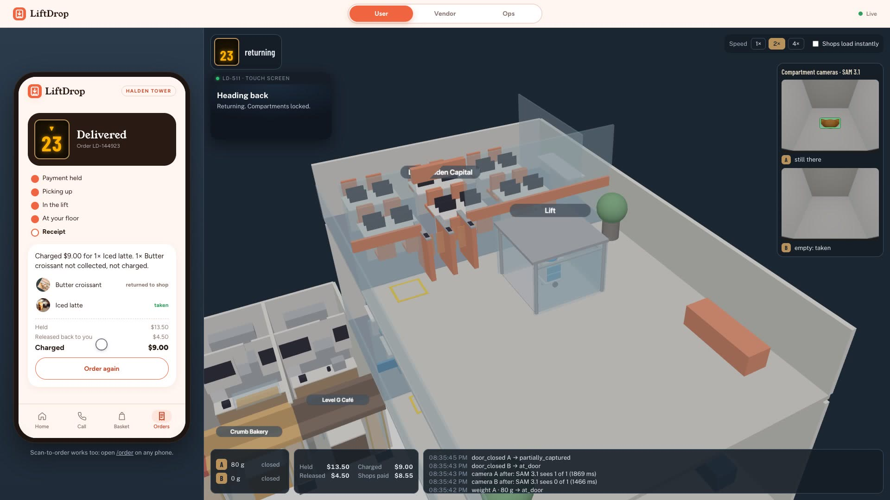
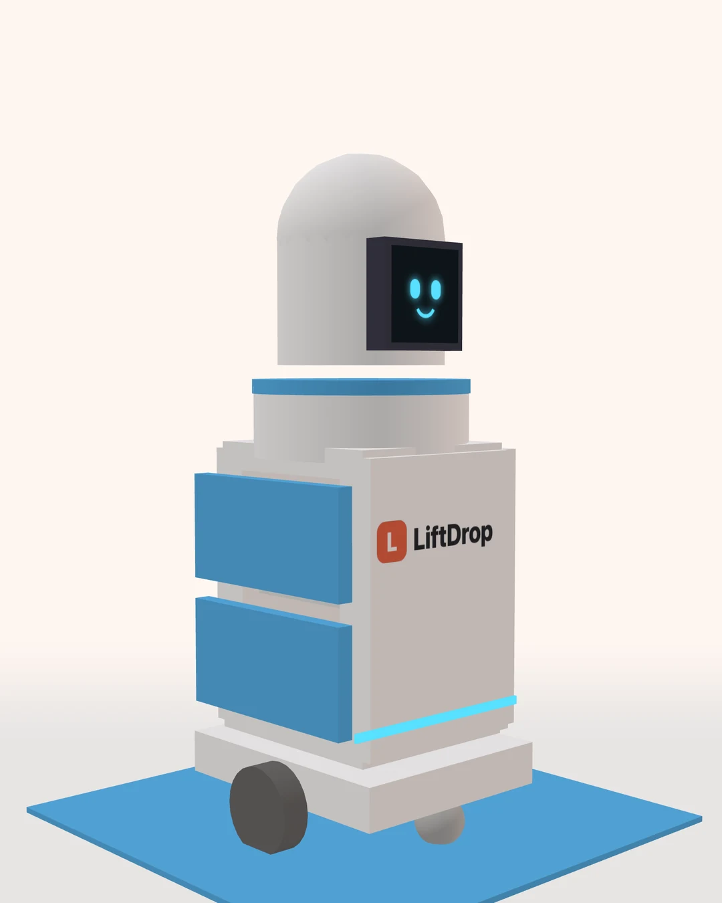

# LiftDrop

LiftDrop is one intelligent AI system that connects lobby shops to every floor of an office tower: voice ordering, a robot that rides the lift, AI vision at your door, and PayPal payments that settle without a human.

AI runs at every step where a person would normally decide something. An agent takes the order on a phone call, a vision model checks what the customer actually took, and another agent decides what to charge when the sensors disagree. PayPal holds the money, charges only for what was taken, and pays each shop its share.

Built for the PayPal AI Hackathon, 2026.



*A live run in `/demo`: the scale and SAM 3.1 agree compartment B was emptied and A was not, so PayPal captures $9.00 of the $13.50 hold, releases $4.50, and pays the shop $8.55.*



## The problem

A lot of office workers eat at their desks, and the shops in the lobby lose that lunch to delivery apps that charge them 15–30% and send a courier who can't get past the security gate. LiftDrop keeps the order in the building and runs it end to end without a courier or a cashier: the lobby shops sell to the floors above them, AI handles the ordering and the checking, a robot handles the lift and the security gate, and PayPal handles the money.

## How it works

One order, start to finish. The AI steps are marked.

1. **Order (AI).** The customer picks from four lobby counters (café, bakery, noodles, salad) in the phone app, or calls the order line. On the call, a Muse Spark agent answers from each shop's dish facts and the live menu, builds the basket with tool calls and puts the PayPal button on the caller's screen. Ordering is hands-free: you can keep typing, reading or walking while you talk, and only tap once at the end to approve in PayPal.
2. **Hold.** PayPal authorizes the full basket. Nothing is captured yet.
3. **Collect.** The robot visits each shop. The shop's tablet shows the order, a compartment opens, and staff load it.
4. **Deliver.** The robot rides the lift to the customer's floor (L20 or L23) and waits at the security gate. The customer unlocks it with a 4-digit code.
5. **Check (AI).** Each compartment has a scale and a camera. Before the doors open and after they close, the weight is compared and SAM 3.1 looks for each dish in the photo.
6. **Decide (AI).** When the scale and camera agree, the charge follows from them. When they disagree, an LLM agent reads both and decides what to charge, whether to wait for another reading, or whether to send the order to a person (Muse Spark, or any OpenAI-compatible model). Code limits it so it can never charge for anything the sensors didn't confirm was taken. With no key set, a fixed rule set decides, and anything it can't decide goes to the ops console.
7. **Settle.** PayPal captures only what was taken and voids the rest. Items left behind ride back to their shop. Items marked *final sale* (drinks, soup) are charged once made.
8. **Pay shops.** PayPal Payouts sends each shop its share, less a 5% platform fee, the moment the order settles.


## How LiftDrop uses PayPal and AI

LiftDrop runs on the **PayPal sandbox** and uses AI in four places: taking orders by phone, hearing and speaking on that call, checking each compartment with a camera, and settling orders the sensors can't agree on.

### PayPal tools (sandbox)

| PayPal tool | Call | What it does in LiftDrop |
|---|---|---|
| **PayPal JavaScript SDK** (Smart Payment Buttons, `intent=authorize`) | `components/Pay.tsx` | The customer approves the order in PayPal on the phone screen, from the app basket or straight from the phone call. |
| **OAuth 2.0** | `POST /v1/oauth2/token` | Server-side access token for every API call below. |
| **Orders v2** | `POST /v2/checkout/orders` (`intent: AUTHORIZE`), `POST /v2/checkout/orders/{id}/authorize` | Holds the full basket on the customer's account. Nothing is charged while the order is on its way. |
| **Payments v2: capture** | `POST /v2/payments/authorizations/{id}/capture` | When the doors close, charges exactly what the scale and camera agree was taken. A partial capture sets `final_capture: true`, which releases the rest of the hold in the same call. |
| **Payments v2: void** | `POST /v2/payments/authorizations/{id}/void` | Nothing taken, or the order is cancelled: the whole hold is released and nothing is charged. |
| **Payouts v1** | `POST /v1/payments/payouts`, `GET /v1/payments/payouts/{batch_id}` | Pays the shops: one batch per order, one item per shop, each shop's share minus the 5% LiftDrop fee. The app polls the batch until PayPal confirms each shop was paid. |

Every money call sends a `PayPal-Request-Id`, so a retry returns the first result and never charges or pays twice, and every money move is written to a ledger table. Code: `lib/paypal.ts` (client, plus a local mock with the same behaviour), `lib/orders.ts` (when each call happens), `lib/handoff.ts` (what to charge).

| Customer takes | PayPal call | Result |
|---|---|---|
| Everything | capture, full amount | Charged the total |
| Part of it | capture part, `final_capture: true` | Charged for what was taken, the rest released |
| Nothing | void | Nothing charged |

Items a shop marks *final sale* (drinks, soup) are charged even if left behind, and their shop is still paid.

### AI tools

| AI tool | Model / service | What it does in LiftDrop | Code |
|---|---|---|---|
| **Meta Muse Spark** | `muse-spark-1.1`, Meta API (`/v1/chat/completions`) | The phone-order agent, so customers can order hands-free while they keep working. It answers questions from each shop's dish facts (allergens, sizes, house rules) and the live menu, and acts through tools: `update_basket`, `checkout` (puts the PayPal approve button on the caller's screen), `set_floor`, `order_status`, `end_call`. | `app/api/call`, `lib/call/` |
| **Meta SAM 3.1** (Segment Anything) | `sam-3.1`, Meta API (`/v1/responses`) | Looks for each dish in the compartment camera's photo as the doors open and as they close, and returns boxes with confidences. A compartment is charged only when SAM and the scale both say it was emptied. | `app/api/vision`, `lib/vision.ts` |
| **Handoff agent** (LLM) | Muse Spark by default; any OpenAI-compatible model via `LLM_BASE_URL` / `LLM_MODEL` (OpenRouter supported) | When the scale and camera disagree, it reads both and proposes what to charge, wait for, or send to a person. Code clamps the proposal: it can never charge for a compartment the sensors didn't confirm as taken. With no key, a fixed rule set decides. | `lib/handoff.ts` |
| **AssemblyAI** | Universal Streaming speech-to-text (v3, WebSocket), text-to-speech | Hears the caller in real time and speaks the agent's replies on the phone call. | `lib/voice/`, `app/api/asr-token`, `app/api/tts` |

### Other tools and technologies

- **Next.js 16** (App Router), **React**, **TypeScript**: the customer app, the shop tablet, the ops console and all API routes.
- **MuJoCo** (compiled to WebAssembly) and **three.js**: the robot, the lift and the tower, simulated and drawn live in the browser. The compartment cameras are rendered from the simulation, and those frames are what SAM 3.1 checks.
- **Supabase** (Postgres): orders, compartments, the money ledger, handoff decisions and robot heartbeats (`supabase/migrations`).
- **Vercel**: hosting, plus a daily **Vercel Cron** job that keeps the database awake.
- **Playwright**: the end-to-end browser test of a full order (`npm run e2e`).
- **Node's built-in test runner**: unit tests (`npm run check`).

**Sponsor integrations:** none. LiftDrop does not use APIMatic, Postman/Astro or Render.

## The demo

| URL | What it is |
|---|---|
| `/` | Landing page |
| `/demo` | The live demo: customer phone + robot sim, shop tablet and ops console under one toggle (`?view=user\|vendor\|ops`). All three stay running when you switch. |
| `/order` | The customer app on its own, for a real phone |
| `/vendor?shop=cafe` | A shop's tablet (`cafe`, `bakery`, `noodles`, `greens`) |
| `/ops` | Ops console: orders that need a person, fleet, ledger |

With `TOUR=on`, a pointer walks first-time visitors through one order across all three views, moving on as the app actually gets there.

The robot and the tower are simulated live in the browser with MuJoCo (WASM) and drawn with three.js. The compartment cameras render real frames from the sim, and those frames are what SAM 3.1 sees.

## Run it

Needs Node 24 (the tests run TypeScript directly).

```bash
npm install
cp .env.example .env
npm run dev          # http://localhost:3000
```

With an empty `.env` everything runs on mocks: PayPal is simulated, the database is in memory, and the handoff uses the fixed rules. Fill in keys to turn on each real service:

| Variables | Turns on |
|---|---|
| `PAYPAL_MODE=sandbox`, `PAYPAL_CLIENT_ID`, `PAYPAL_CLIENT_SECRET`, `NEXT_PUBLIC_PAYPAL_CLIENT_ID` | PayPal sandbox checkout, capture, void |
| `PAYOUT_EMAIL_CAFE` / `_BAKERY` / `_NOODLES` / `_GREENS` | Payouts to each shop's sandbox business account |
| `SUPABASE_URL`, `SUPABASE_SERVICE_ROLE_KEY` | Postgres storage. Apply `supabase/migrations/*.sql` in order. |
| `LLM_BASE_URL`, `LLM_API_KEY`, `LLM_MODEL` (or `OPENROUTER_API_KEY`) | LLM handoff agent |
| `META_API_KEY` | Muse Spark for the phone call, SAM 3.1 for the cameras |
| `ASSEMBLYAI_API_KEY` | Speech-to-text and text-to-speech for the phone call |
| `OPS_TOKEN` | Optional: locks the operator actions on `/api/ops` (sent as `x-ops-token`). |
| `SANDBOX_BUYERS` | PayPal sandbox buyer logins (`email password, email password`) shown under the demo phone with copy buttons, sandbox mode only |
| `TOUR=on` | Guided tour over `/` and `/demo`: first-time visitors are asked once, and a corner switch turns it on or off. Any other value hides it completely. |

## Deploy

Runs on Vercel as is (or any Node host with `npm run build && npm start`). No server memory is relied on:
robot heartbeats live in the `robots` table, the payout batch is sent through Next's `after()`, and
payouts in progress, unclaimed orders and robots stuck at the door are swept on each `/api/state` read.
Set the variables above in the project settings, including `NEXT_PUBLIC_PAYPAL_CLIENT_ID` before the
first build (it is baked into the page), and apply `supabase/migrations/*.sql`.

A Vercel Cron job (`vercel.json`) calls `/api/cron/keepalive` once a day. It reads the menu and orders,
cancels paid orders no robot finished, syncs payouts and clears old robot heartbeats, so the Supabase
free tier never sees a week without activity and pauses the database. Set `CRON_SECRET` in the project
settings: Vercel sends it as a bearer token and the route then rejects every other caller.

## Tests

```bash
npm run typecheck
npm run check        # unit tests: order lifecycle, handoff decisions, camera checks, fleet, ops, sim, call tools
npm run e2e          # browser run of the full demo; start the server with PAYPAL_MODE=mock first
```

## Layout

```
app/            pages and API routes (Next.js 16 app router)
components/     phone app, call screen, robot stage, tower view, shop tablet parts
lib/            orders, PayPal, handoff, vision, call agent, sim (MuJoCo tower controller)
sim/            MuJoCo scene: tower, lift, robot
supabase/       database migrations
scripts/        e2e test, cover render, demo footage capture
```

## Limits

- The robot, lift and building are simulated. The control code and the compartment checks are written against the sim's sensors, not a real robot.
- The final-sale toggle (`/api/items/[id]`) has no auth, and the voice and vision routes have no rate limit yet.

## License

MIT, an OSI-approved license. See [LICENSE](LICENSE).
